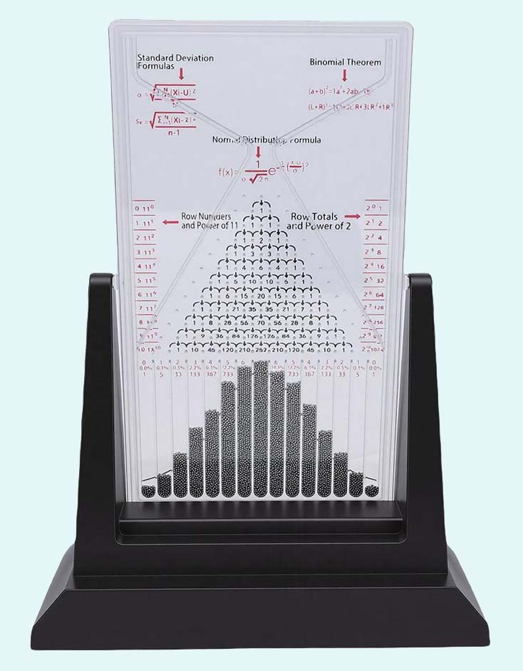

# Galtonova deska a binomické rozdělení

## Jak to funguje

Galtonova deska demonstruje základní koncept statistiky - jak se dívat na výsledek mnoha pokusů, které jsou ovlivněny náhodou.

V Galtonově desce se po jedné sypou kuličky přes několik vrstev kolíčků (v každé vrstvě kolíčku se jejich počet zvyšuje o jeden kolíček).

Jakmile kulička narazí na první kolík, má (v ideálním případě) 50% pravděpodobnost, že se odrazí doleva, a 50% pravděpodobnost, že se odrazí doprava.

Kulička nakonec skončí v jedné z dolních přihrádek. Celý půvab Galtonovy desky spočívá s postupném nasypání mnoha kuliček, takže jejich počty v jednotlivých přihrádkách vytvoří hromádku se tvaru zvonovité křivky.

{width=40%}

## Počet možných drah kuličky do dané přihrádky

Procesu průchodu každé kuličky vrstvami kolíčků lze popsat popsat pomocí

- sady **mikrostavů** představujících popis dráhy každé jednotlivé kuličky

- a výsledným **makrostavem** - což je v případě jedné kuličky pozice přihrádky v které kulička skončí

- počtu různých **mikrostavů** vedoucích k nějakému **makrostavu** se nazývá **multiplicita** makrostavu.

Počty možných drah jedné kuličky do nějaké přihrádky znázornit následujícícm obrázkem (známým jako Pascalův trojúhelník). Čísla uvnitř kolíčků (modrá kolečka) označují kolika způsoby se kulička mohla dostat k danému kolíčku.

Hodnoty v (zelených) přihrádkách (očíslovaných od 0) jsou tedy počtem různých drah, jakými se kulička může dostat do dané přihrádky K.

```{julia}
#| echo: false
#| output: true  #asis
#| fig-cap:  "Počty možných drah kuličky v Galtonova desce"
#| fig-cap-location: bottom  # margin
#| 
using Plots

# Compute Pascal triangle values
function pascal_triangle(N)
    tri = Vector{Vector{Int}}(undef, N+1)
    tri[1] = [1]
    for r in 1:N
        prev = tri[r]
        row = [1; [prev[i] + prev[i+1] for i in 1:(length(prev)-1)]; 1]
        tri[r+1] = row
    end
    return tri
end

# Coordinates for triangular layout
function pascal_coords(N)
    coords = Dict{Tuple{Int,Int},Tuple{Float64,Float64}}()
    for r in 0:N
        for c in 0:r
            x = c - r/2          # center each row
            y = -r               # row spacing downward
            coords[(r, c)] = (2*x, 2*y)
        end
    end
    coords
end

# Plot Pascal triangle using circles + labels + arrows (quiver)
function plot_pascal(N=7)
    tri = pascal_triangle(N)
    coords = pascal_coords(N)

    # Collect node positions and labels
    xs, ys, labels = Float64[], Float64[], String[]
    for r in 0:N
        for c in 0:r
            x, y = coords[(r, c)]
            push!(xs, x)
            push!(ys, y)
            push!(labels, string(tri[r+1][c+1]))
        end
    end

    mcolor = vcat(fill(:lightblue, div(N*(N+1), 2)), fill(:lightgreen, N+1))

    # Base scatter plot (circles)
    plt = scatter(
        xs, ys,
        markersize=18,
        markercolor=mcolor,#[:lightblue, :red],
        markerstrokecolor=:black,
        markerstrokewidth=1.5,
        aspect_ratio=:equal,
        legend=false,
        # axisoff=true,
        xlims=(-N-3, N+1),
        xticks=((-N):2:N, 0:1:N),
        xlabel="Číslo přihrádky K",
        ylims=(-2*N-1, 3),
        yticks=(2:-2:(-2*N), string.(["Trychtýř"; collect(0:(N-1)); "Přihrádky"])),
        ylabel="Vrstva kolíčků M (kolikátý odraz kuličky)",
        title="Počty možných drah (N = $N)",
        size=(900, 600)
    )

    scatter!(plt, [0], [2], markersize=18,
        markercolor=:red,
        markerstrokecolor=:black,
        markerstrokewidth=1.5,)

    quiver!(plt, [0], [1.5], quiver=([0], [-1]),
        linecolor=:red, line=3,
        arrow=true)

    # Labels inside circles
    for (x, y, lbl) in zip(xs, ys, labels)
        annotate!(plt, x, y, text(lbl, 8, :black, halign=:center)) #, valign=:middle))
    end

    # Arrows using quiver!
    for r in 0:(N-1)
        for c in 0:r
            x1, y1 = coords[(r, c)]
            x1=x1 .- 0.5
            y1=y1 .- 0.5

            # left child
            x2, y2 = coords[(r+1, c)]
            x2=x2 .+ 0.2
            y2=y2 .+ 0.7
            quiver!(plt, [x1], [y1], quiver=([x2-x1], [y2-y1]),
                linecolor=:black,
                arrow=true)

            # right child
            x1, y1 = coords[(r, c)]
            x1=x1 .+ 0.5
            y1=y1 .- 0.5
            x3, y3 = coords[(r+1, c+1)]
            x3=x3 .- 0.2
            y3=y3 .+ 0.7
            quiver!(plt, [x1], [y1], quiver=([x3-x1], [y3-y1]),
                linecolor=:black,
                arrow=true)
        end
    end

    plt
end

plot_pascal(3)

```

```{julia}
#| echo: false
#| output: true  #asis

plot_pascal(5)
```

```{julia}
#| echo: false
#| output: true  #asis

plot_pascal(10)
```

Zavedeme li notaci:

- $N$ je počet vrstev kolíčků

- $M \in (1,N)$ označení vrstvy kolíčků (v které je $M$ kolíčků )

- $K \in (0,N)$ je pořadí přihrádky (počítané zleva od 0, $K$ představuje kolikrát se kulička odrazila doprava)

V každé vrstvě kolíků se kulička odráží (od jednoho z kolíku v této vrstvě) náhodně nalevo nebo napravo. V teorii pravděpodobnosti a statistice se takovýto náhodný pokus, který má právě dva možné výsledky označuje jako Bernoulliho pokus.

Odraz se pro každou kuličku opakuje nezávisle N-krát a odraz v každé vrstvě nezávisí na odrazu v předchozich vrstvách). Takovýto náhodný pokus - opakování Bernoulliho pokusu N-krát a spočtení počtu jedno z možných výsledků (např. počtu odrazů napravo) se pak označuje jako binomický pokus. Pravděpodobnost, že kulička skončí s přihrádce K je dáno počtem možných drah do této přihrádky.

Počet možných drah ke každému kolíčku je jednoduchým součtem počtu možných drah pro kolíček nalevo a napravo v předcházející vrstvě kolíčků. Pokud označíme

$C(M,K)$ jako počet možných drah jedné kuličky do kolíčku $K$ ve vrstvě $M$

pak lze předchozí jednoduchý součet zapsat jako:

$$\begin{equation}
C(M,K)=C(M-1,K-1)+C(M-1,K)
\end{equation}
$$

s počátečními podmínkami:

$$\begin{equation}
C(0,0)=1
\end{equation}
$$

$$\begin{equation}
C(1,0)=1
\end{equation}
$$

$$\begin{equation}
C(1,1)=1
\end{equation}
$$

Číslo $C(M,K)$ se nazývá kombinační číslo, které udává počet způsobů, jak vybrat K prvků z M množiny (bez ohledu na pořadí prvků ve výběru). Kromě naznačeného rekuretního výpočtu lze hodnoru kombinačního čísla vypočítat pomocí faktoriálů:

$$\begin{equation}
C(M,K)=\frac{M!}{K!(M-K)!}
\end{equation}
$$

## Pravděpodobnost kulička v K-té přihrádce

Protože se počet možných (různých) drah jedné kuličky se každé vrstvě kolíčků zdvojnásobí, je celkový počet možný různých drah kuličky roven:

$$\begin{equation}
T(N)=2^N
\end{equation}
$$

a pravděpodobnost $P_N(K)$, že kulička skončí v přihrádce $K$ je tedy rovna:

$$\begin{equation}
P_N(K)=C(N,K) \cdot  \frac{1}{2^N}
\end{equation}
$$

Tyto pravděpodobnosti ukazuje následující obrázek pro několik hodnot $N$, který dobře vysvětluje tvar hromádky kuliček na reálné Galtonově destičce.

```{julia}
#| echo: false
#| output: true  #asis
#| fig-cap:  "Pravděpodobnosti kuličky v přihrádce K po N odrazech"
#| fig-cap-location: bottom  # margin

using Plots, LaTeXStrings, Plots.PlotMeasures

using SpecialFunctions   # for binomial

# Binomický koeficient C(n,k)
C(n, k) = binomial(n, k)

# Pravděpodobnost P(N,K)
P(n, k) = C(n, k) / 2^n

# Vygeneruj všechny P(N,K) pro K = 0..N
function pascal_probabilities(N)
    [P(N, K) for K in 0:N]
end

function plot_mult(N)
    # # Plot as bar chart
    p = bar(collect(0:N), [P(N, K) for K in 0:N],
        xlabel=L"K", ylabel=L"P_N(K)",
        # xlim=(N - 1, 6 * N + 1), 
        xticks=0:N,
        title="N=$N", label=nothing
    )
    return p
end

plots = [plot_mult(i) for i in collect(1:1:12)]
# Arrange them in a 3x3 grid
plot(plots...,
    layout=(4, 3),
    size=(900, 600),
    left_margin=[5mm 5mm],
)
```

Nicméně tvar hromady kuliček, kterou pozorujeme po každém otočení Galtonovy destičky nemuže být přesně onou zvonovitou křivkou vypočtenou z četnosti drah kuliček. 
Počet kuliček $L$ v zásobníku Galtonovy destičky je vždy celé číslo a součin 

$$
\begin{equation}
E_{N,L}(K)=P(N,K) \cdot L
\end{equation}
$$

tedy vyjadřuje jen střední hodnotu očekávaného počtu kuliček z přihrádce K.

## Simulace Galtonovy desky s různým počtem kuliček


Další obrázek ukazuje několik realizaci  otočení Galtonovy destičky se 3 různými vrstvami kolíčků s různým počtem $L$ nasypaných kuliček.  Ukazuje vždy počty kuliček v přihrádkách, vždy  4 simulace (otocení Galtonovi desky) pro 3 různé hodnoty $L$.


```{julia}
#| echo: false
#| output: true  #asis
#| fig-cap:  "Simulace počtu kuliček na  hromadě (po L kuličkách po N odrazech)"
#| fig-cap-location: bottom  # margin

using Plots, LaTeXStrings, Plots.PlotMeasures

using SpecialFunctions   # for binomial

# Binomický koeficient C(n,k)
C(n, k) = binomial(n, k)
E(n, k, l) = C(n, k) / 2^n*l

# Vygeneruj všechny P(N,K) pro K = 0..N
function E_all(N, L)
    [E(N, K, L) for K in 0:N]
end

# generuj prihradky
using SpecialFunctions   # for binomial()

# Jedna simulace binomického výsledku K ~ Binomial(N, p)
binom_sample(N, p) = sum(rand() < p for _ in 1:N)

# Provedeme L simulací a spočítáme histogram 0..N
function binom_histogram(N, p, L)
    counts = zeros(Int, N+1)   # index 1 -> K=0, index N+1 -> K=N

    for _ in 1:L
        K = binom_sample(N, p)
        counts[K+1] += 1       # posun o 1 kvůli indexování
    end

    return counts
end

function plot_mult(N, L, ith)
    # # Plot as bar chart
    p = bar(collect(0:N), [binom_histogram(N, 0.5, L)],
        xlabel=nothing, ylabel=nothing,
        # xlim=(N - 1, 6 * N + 1), xticks=N:xstep:6N,
        title="simulace#:$ith  L=$L N=$N",
        label="",  #"simulace",
        color=:lightblue
    )
    plot!(p, collect(0:N), [E_all(N, L)],
        xlabel=nothing, ylabel=nothing,
        # xlim=(N - 1, 6 * N + 1), xticks=N:xstep:6N,
        label=L"E_N(L,K)",
        line=3, color=:red
    )
    return p
end

plots = [
    plot_mult(N, L, ith) for (N,L, ith) in
        zip(
            vcat(fill([5, 7, 10], 5)...),
            vcat(fill([15, 150, 500], 5)...),
        vcat([ fill(i,3) for i in 1:5]...)
    )
]
# Arrange them in a 3x3 grid
plot(plots...,
    layout=(5, 3),
    size=(900, 1400),
    left_margin=[5mm 5mm],
)

```

Skutečné počty se  mezi jednotlivými simulacemi (otočeními Galtonovy destičky) liší,
ale se zvětšujícím se počtem kuliček $L$ v zásobníku se  tvar hromady více
a více blíží k očekávanému počtu $E_N(K)$ kuliček v přihrádce K.

Přes to všechno je skutečně pozorovaný počet kuliček, v přihrádce $K$ po vypuštění $L$ kuliček, a   $N$ odrazech každé z nich, jen náhodná veličina, o které mužeme odvodit její rozložení. 

## Rozložení pravděpodobnosti četnost kuliček v přihrádce $K$

Počet kuliček $S(N,K,L)$ v přihrádce $K$ po vypuštění $L$ kuliček (a jejich  $N$ odrazech) je náhodná veličina, kterou lze charakerizovat  pravděpodobnostmi $P_{N,L}(K,l)$  že  $S_{N,L}(K)$ bude rovno nějakému $l \in (0...L)$.

Označíme-li 

- $p=P_N(K)=C(N,K) \cdot  \frac{1}{2^N}$ jako pravděpodobnost, že jedna kulička **skončí** právě K-té přihrádce

- $q=1-p$  jako pravděpodobnost, že jedna kulička **neskončí** v K-té přihrádce

pak pravděpodobnost $P_{N,L}(K,l)$, že z $L$ kuliček jich v K-té přihrádce skončí právě a jen $l$, 
je dána binomickým rozložením s parametry $p$ a $q$:


$$
\begin{equation}
P_{N,L}(K,l)=C(L,l) \cdot p^k \cdot q^{(L-k)}
\end{equation}
$$

kde C(L,l) je opět kombinační číslo.

Nasledující grafy ukazují pravděpodobnosti $P_{N,L}(K,l)$ pro několik hodnot N a
L, svislé čáry označují očekávanou střední hodnotu počtu kuliček v K-té přihrádce.


```{julia}
using SpecialFunctions
using Plots
using SpecialFunctions

C(n, k) = binomial(BigInt(n), k)

P(L, l, p) = C(L, l) * p^l * (1-p)^(L-l)

function one_distr(N, L, xmax, ylab,shift,xstep)
    plt = plot(
        title="Binomické rozdělení "*L"P_{N,L}(K,l)"*" pro N=$N odrazů a L=$L kuliček",
        xlabel=L"l"*" - počet kuliček v přihrádce K",
        ylabel=L"P_{N,L}(K,l)" * " - pravděpodobnost  " * L"l" * " kuliček v K-té přihrádce ",
        legend=:topright,
        xticks=0:xstep:xmax,
        xlim=(shift, xmax),
        size=(900, 600),
        left_margin=5mm,
        bottom_margin=5mm,
    )

    function vline_limited!(p, x; ymin=0, ymax=maximum(p[1][:y]), color=:gray, lw=0.5, ls=:dash)
        plot!(p, [x, x], [ymin, ymax], lw=lw, ls=ls, label="")
    end

    # Pro každé L vykreslíme celou křivku P(L,l)
    for K in 0:div(N, 2)
        pNK = C(N, K)/2^N
        vals = [P(L, l, pNK) for l in 0:L]
        plot!(plt, [0:L], vals, lw=2, label="K = $K nebo K=$(N-K)", marker=:dot)
    end
    for K in 0:div(N, 2)
        pNK = C(N, K)/2^N
        vline_limited!(plt, pNK*L, ymax=ylab*0.9)

        annotate!(plt,
            [pNK*L], [ylab],
            L"E_{N,L}(K=" * "$K" * L")" * "\n=$(round(Float64(pNK*L),digits=2))",
            6
        )
    end
    plt
end
one_distr(5, 15, 15, 0.45,-1,1)
```


```{julia}
one_distr(7, 150,60,0.25,-3,5)
```

```{julia}
one_distr(10, 500,150,0.4,-20,20)
```

## Závěr

Galtonova deska vynalezená roku 1874 stále pěkně názorně ukazuje realizaci
několika náhodných procesů (odrazy kuličky od kolíčků) opakovanou přes všechny
kuličky v zásobníku. Tvary a výšky hromádek kuliček v dolních přihrádkách "v
průměru" odpovídají počtu možných drah jakými se kulička může dostat do té
které přihrádky. Nicméně počet pozorovaný po otočení Galtonovy destky
se mění a jedinné co lze odvodit je pravděpodobnost pozorování určitého počtu kuliček v určité přihrádce. 
Ta je dána binomickým rozdělením.
