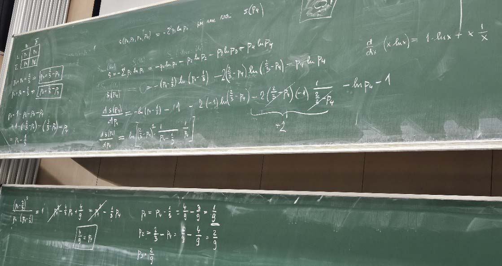

# Australští klokané a princip nedostatečného důvodu 

Australští klokané byly vzevrubně zkoumáni ve dvou studiích:

- prvni se  zabývala kolik z nich je levorukých a zjistila, že je to 1/3 ze všech klokanů

- druhá studie analyzovala kolik z nich pije pivo a také zjistila, že je to 1/3 ze všech klokanů

Nediskutujme teď o tom kdo studie financoval, ani jak mohou zviřata pít
Australské pivo (známé svou vodnatelností a hlavně dávkováním v sklenicích
velikosti 2 decilitru).

Úkolem je zjistit pravděpodobnost, že klokan je levoruký a zároveň pije pivo.

Pokud znovu použijeme metodu maximální entropie je to zdánlivě jednoduché
řešení maximalizace, podobné, ba jednodušší, než
[Řešení MAXENT principu pro systém s 3 stavy](https:../../../s1_nahoda_chaos/posts/p9_optimalizace/maxent_optimalizace_3.html).
Právě jednoduchost řešení umožňuje se zamyslet, co je za MaxEnt principem.

## Zadání

Mějme pravděpodobnosti v populaci klokanů popsány následující kontingenční tabulkou:

|Levorukost\\Piják piva | Ano pije  | Nepije  | Suma v řádku
| ----- | ----- | ----- | ----- | 
Levoruký | $p_1$ | $p_2$ | $\frac{1}{3}$ |
Pravoruký | $p_3$ | $p_4$ | $\frac{2}{3}$ |
Suma Sloupců | $\frac{1}{3}$     | $\frac{2}{3}$    | 1

**Součty pravděpodobností jsou jedinné hodnoty, které nám poskytly zmíněné studie.**

Úkolem je stanovit hodnoty $p_1,p_2,p_3,p_4$, které musí splňovat následující podmínky:

$$
\begin{equation}
p_1+p_2=\frac{1}{3}
\end{equation}
$$

$$
\begin{equation}
p_1+p_3=\frac{1}{3}
\end{equation}
$$

$$
\begin{equation}
p_1+p_2+p_3+p_4=1
\end{equation}
$$

Protože máme 3 podmínky pro 4 neznámé (t.j. stav částečné (neúplné) informace)
měli bychom zvolit takové rozdělení pravděpodobnosti, které má maximální
entropii (nejvyšší možnou nejistotu) vzhledem k daným omezením. MaxEnt princip
je statistickým vyjádřením tohoto přístupu.

## Řešení pomocí MaxEnt

Entropie rozdělení klokanů na leváky a pijáky je definována:

$$
\begin{equation}
S(p_1,p_2,p_3,p_4)=-\sum_{i=1}^4{\bigl( p_i \cdot log(p_i) \bigr)}
\end{equation}
$$

Protože mužeme ze 3 ze 4 proměnných vyjádřit pomocí (např.) pravděpodobnosti $p_1$. 
Rovnici pro $S(p_1,p_2,p_3,p_4)$ tak převedeme na funkci jedné proměnné.

$$
\begin{equation}
p_2=\frac{1}{3}-p_1
\end{equation}
$$

$$
\begin{equation}
p_3=\frac{1}{3}-p_1
\end{equation}
$$

$$
\begin{equation}
p_4=1-p_1-(\frac{1}{3}-p_1)-(\frac{1}{3}-p_1)=p_1+\frac{1}{3}
\end{equation}
$$

$$
\begin{align}
S(p_1,p_2,p_3,p_4)=S(p_1)=-p_1 \cdot log(p_1)-(\frac{1}{3}-p_1) \cdot log(\frac{1}{3}-p_1)\\
- (\frac{1}{3}-p_1) \cdot log(\frac{1}{3}-p_1)-(p_1+\frac{1}{3}) \cdot log(p_1+\frac{1}{3})
\end{align}
$$

Pro hlédání maxima odvodíme derivaci funkce $S(p_1)$ polde $p_1$:
$$
\begin{align*}
\frac{\mathrm{d}S(p_1)}{\mathrm{d}p_1}&=-log(p_1)-1+2log(\frac{1}{3}-p_1)+2-log(p_1-\frac{1}{3})-1\\
&=log \left[ {\left (\frac{1}{3}-p_1 \right)}^2 \frac{1}{p_1} \frac{1}{(p_1+\frac{1}{3})}\right]
\end{align*}
$$

Maximum funkce je rovno hodnotě $p_1^*$, kde je derivace 
$\frac{\mathrm{d}S(p_1)}{\mathrm{d}p_1}$ 
rovna 0 (t.j.logaritmus v předchozí rovnici je roven 1).

$$
\begin{equation}
\left[ {\left (\frac{1}{3}-p_1^* \right)}^2 \frac{1}{p_1^*} \frac{1}{(p_1^*+\frac{1}{3})}\right]=1
\end{equation}
$$

vynásobením dostaneme

$$
\begin{equation}
\frac{1}{9}-\frac{2}{3}p_1^*+(p_1^*)^2=(p_1^*)^2+\frac{1}{3}p_1^*
\end{equation}
$$

a po zjednodušení

$$
\begin{equation}
\frac{1}{9}=\frac{1}{3}p_1^*
\end{equation}
$$

vychází
$$
\begin{equation}
p_1^*=\frac{1}{9}
\end{equation}
$$

a pak již jen dosazením do vzorců pro $p_2,p_3,p_4$ dostaneme hodnoty
pravděpodobností $p_2^*,p_3^*,p_4^*$ odpovídající maximální entropii.

$$
\begin{equation}
p_2^*=\frac{1}{3}-p_1^*=\frac{2}{9}=p_3^*
\end{equation}
$$

$$
\begin{equation}
p_4^*=p_1^*+\frac{1}{3}=\frac{4}{9}
\end{equation}
$$

## Princip nedostatečného důvodu

Úloha a diskuze okolo tématu Australských klokanů je zdánlivě jednoduché řešení
maximalizace. MaxEnt metoda dává následující výsledek:

|Levorukost\\Piják piva | Ano pije  | Nepije  | Suma v řádku
| ----- | ----- | ----- | ----- | 
Levoruký | $p_1=\frac{1}{9}$ | $p_2=\frac{2}{9}$ | $\frac{1}{3}$ |
Pravoruký | $p_3=\frac{2}{9}$ | $p_4=\frac{4}{9}$ | $\frac{2}{3}$ |
Suma Sloupců | $\frac{1}{3}$     | $\frac{2}{3}$    | 1

Nicméně výsledky studií ($\frac{1}{3}$ levorukosti a $\frac{1}{3}$ pijáků)
splňuje i následující tabulka pravděpodobností:

|Levorukost\\Piják piva | Ano pije  | Nepije  | Suma v řádku
| ----- | ----- | ----- | ----- | 
Levoruký | $p_1=\frac{1}{6}$ | $p_2=\frac{1}{6}$ | $\frac{1}{3}$ |
Pravoruký | $p_3=\frac{1}{6}$ | $p_4=\frac{1}{2}$ | $\frac{2}{3}$ |
Suma Sloupců | $\frac{1}{3}$     | $\frac{2}{3}$    | 1

V čem je MaxEnt výsledek lepší ? Splňuje **„princip nedostatečného důvodu“**, který zhruba říká:

- Nepřidávat do modelu žádné skryté předpoklady, data či uspořádání, pro které nemáme oporu v datech.

- Pokud něco nastane nebo existuje v určitém stavu namísto jiného, musí k tomu existovat dostatečný důvod. 

Co nám přidává do znalostí o klokanech druhá tabulka ? 

Pokud např. identifikujeme levorukého klokana (první řádek) pak predikuje s
pravděpodobností

$$
\begin{equation}
p_{piják} \{\text{klokan je levoruký} \}=\frac{\frac{1}{6}}{\frac{1}{6}+\frac{1}{6}}=\frac{1}{2}
\end{equation}
$$

(Ačkoliv někteří znalci australských realií s tímto výsledkem mohou souhlasit,)
**základní data z obou studií nic takového neobsahují**, studie jen říkají, že
existuje $\frac{1}{3}$ levorukosti a $\frac{1}{3}$ pijáků a nás nic
neospravedlňuje přidávat nějakou závislost levorukosti a pijáctví. 

V případě MaxEnt řešení je levoruký klokan pijákem s pravděpodobností:

$$
\begin{equation}
p_{piják} \{\text{klokan je levoruký} \}=\frac{\frac{1}{9}}{\frac{1}{9}+\frac{2}{9}}=\frac{1}{3}
\end{equation}
$$

což plně splňuje výsledky druhé studie o $\frac{1}{3}$ pijáků.

## Závěr

Princip nedostatečného důvodu (anglicky Principle of Insufficient Reason) je
filozofický přístup razící premisu:  nemáme-li žádný pádný důvod předpokládat, že jedna z
možností nastane s větší pravděpodobností než jiná, máme všem možným variantám
připsat stejnou pravděpodobnost. 

(Ne)překvapivě, mnohé přírodní zákony ukazují, že pokud získáme nějakou znalost o
chování fyzikálních systémů, nesmíme předpokládat, že tato znalost nám
pomůže v jiné oblasti, pro které jsme žádná data nezískali. Příroda nám poskytuje jen 
svoji maximalní neurčitost omezenou jen nasbíranými daty.

